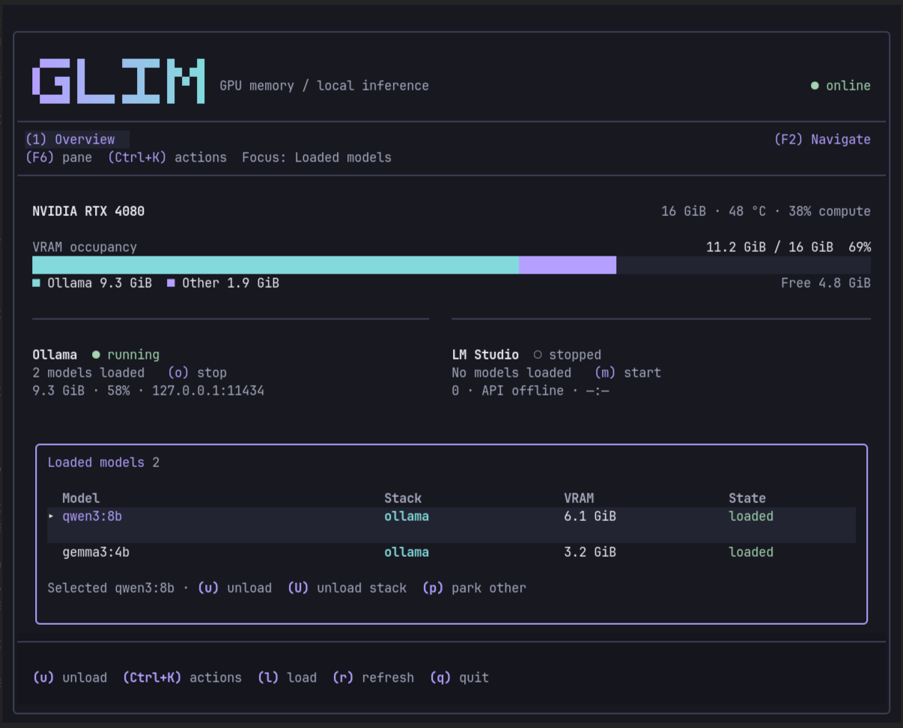

# Glim



GPU landlord for local inference. One terminal screen for the VRAM that **Ollama** and **LM Studio** share.

It shows who is on the GPU, unloads or parks a stack so the other can load, and kills orphan `llama-server` processes left behind when LM Studio crashes.

This is not a chat UI and not a bar plugin.

## Keys

| Key | Action |
| --- | --- |
| `j` / `k` | Move |
| `u` | Unload the selected model |
| `U` | Unload every model on that stack |
| `p` | Park the other stack (unload its models) |
| `l` | Load a model onto the focused stack |
| `r` | Refresh occupancy now |
| `o` | Start or stop Ollama |
| `m` | Start or stop the LM Studio server |
| `x` | Kill the selected orphan (confirm) |
| `F6` / `Shift+F6` | Cycle model list / inspector |
| `Ctrl+K` | Search actions and select a theme |
| `?` | Help |
| `q` | Quit |

Click a tenant row to select it. Scroll the wheel to move.

A compact Glim header sits above the VRAM occupancy meter, stack cards, and model list. F6 focuses the scrollable inspector.

## Safety

Polling never starts LM Studio. `lms` is only run after `~/.lmstudio/.internal/http-server.json` has a live pid whose port is listening. `lms` with no daemon starts `lm-studio --run-as-service`.

Ollama is probed over HTTP (`/api/ps`). Start/stop uses systemd when the unit is loaded, otherwise a user `ollama serve` process. sudo is used only after a permission failure, with the TUI suspended so the password prompt is visible.

## Config

`~/.config/vramtui/config.toml`

```toml
theme = "aurora"
ollama_host = "http://127.0.0.1:11434"
lms_path = ""          # default ~/.lmstudio/bin/lms
vram_budget_mib = 0    # 0 = total minus 2048
gpu_poll_ms = 1000
model_poll_ms = 2000
```

Aurora is the default. Choose Follow Omarchy or Terminal through Ctrl+K; the choice is saved in the existing config file.

## Install

```bash
./install.sh
glim
```

## Aurora interface

New installations use Aurora: charcoal surfaces, lavender focus, cyan data, quiet borders, and compact headers. Existing explicit theme choices and legacy config/data locations are retained. `Ctrl+K` searches actions; Esc closes the palette. Actions use the same confirmations as their keyboard shortcuts. Tab / Shift+Tab changes screens; F6 / Shift+F6 changes panes. F2 opens Navigation. Details scroll with Page Up / Page Down. Narrow layouts show the active pane; the minimum terminal is 30×14.

Build requirements: Rust 1.88 or newer, Ratatui 0.30.2, Crossterm 0.29. Run `cargo test --locked` before `./install.sh`. The command is `glim`; no compatibility command aliases are installed.

See [shared navigation](docs/navigation.md) for keyboard and mouse controls.

Screenshot refreshed from an actual Foot render with sample data.
